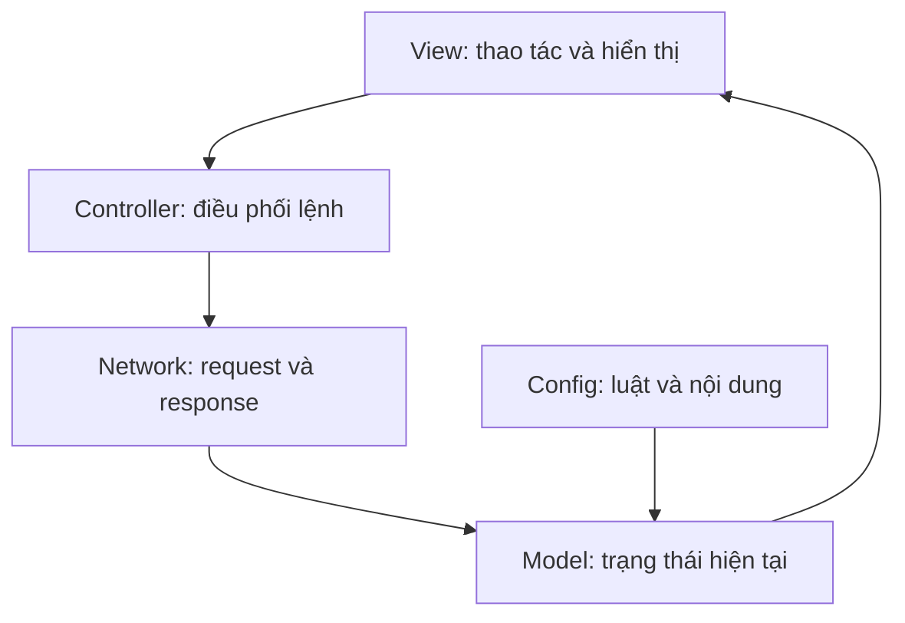

# Phân tích bộ source Hermes bàn giao và hướng áp dụng vào Lục Thần

Cập nhật: **07/09/2026, giờ Việt Nam**. Lục Thần được đối chiếu ở commit `c8fefca0e31b6ddb926921454413d38860171665`. Đây là phân tích source và kế hoạch; không phải một đợt thay gameplay hoặc nghiệm thu toàn game. **Bổ sung theo yêu cầu tiếp theo của anh:** được tái sử dụng code mẫu có chọn lọc; đọc [guide port](HERMES-CODE-REUSE-GUIDE.md) và bản đồ 27 phương thức trong guide. Thân mã gốc nằm trong archive người dùng bàn giao, chưa đưa lên GitHub. Policy mới thay giới hạn cũ chỉ học kiến trúc/cấm source.

Đọc tiếp: [kế hoạch thực thi cho Luna](LUNA-EXECUTION-PLAN-2026-09-07.md), [tiến độ hiện tại](HON-VIET-MONG-GIOI-PROGRESS-2026-09-06.md), [master plan E01–E26](HON-VIET-MASTER-PLAN-SAMKOK-v2-2026-09-06.md).

## 1. Đầu vào, phương pháp và giới hạn bằng chứng

Anh xác nhận game mẫu/bộ source được bàn giao từ Hermes và muốn học cách xây hệ thống để tiếp tục **Lục Thần**, giữ bản sắc riêng. Bảy file `fable5-tam-quoc-source.zip.001` đến `.007` được nối theo thứ tự byte, không giải nén từng part riêng. Sáu phần đầu mỗi phần 41.943.040 byte; phần cuối 12.824.999 byte. Archive ghép có **264.483.239 byte**, SHA-256:

```text
68aea5208f55adf4c6e7d5103c911dbe45f569c8b768a21ab29a6ceec4423115
```

Kiểm CRC bằng `ZipFile.testzip()` không tìm thấy entry hỏng. Có **10.291 file**, tổng kích thước giải nén 500.386.596 byte. [Manifest kiểm kê](reference/hermes-source-manifest-2026-09-07.json) ghi hash, cấu trúc và phạm vi đọc để phiên sau đối chiếu đúng đầu vào.

Metadata `manifest.json` định danh ứng dụng **Tam Quốc Khởi Động**, package `com.jsjsvn.google`, version `1.1.136` / code `136`. Trong bộ này có APK, dữ liệu apktool, JavaScript được tách/giải mã, config và protocol; các file `modules/*.ts` là đoạn `System.register` đã bundle/minify, không phải project TypeScript nguyên bản có type/source map đầy đủ. Chưa thấy backend hay project Cocos Editor có thể build lại chỉ bằng một lệnh. Không suy tác giả từng phần của ứng dụng từ tên gói Hermes.

| Thành phần | Số file | Ý nghĩa |
|---|---:|---|
| `modules/` | 1.748 | Các module UI/controller/model và tiện ích; có thể lần tên method và dependency |
| `decoded-config-vi/` | 169 | Bảng dữ liệu đã decode; một file có nhiều section, không đếm section là số tính năng |
| `decrypted-js/` | 40 | Bootstrap, Cocos runtime, bundle chính, `bccore.js`, `bcwar.js` |
| `protocol/data_protocol.json` | 1 | 1.274 định nghĩa send và 1.414 định nghĩa recv; là schema thông điệp, không phải server thực thi |
| `key-code-assets/` | 50 | Config bundle, archive và metadata liên quan tới tài nguyên |
| `art-audit/` | 19 | Ảnh/summary art đã tách; không đồng nghĩa mọi prefab/motion đã được nghiệm thu |
| `apktool-base/` | 8.218 | Nội dung Android đã unpack; không cần nhập vào game web Lục Thần |

Phương pháp: kiểm kê toàn archive; đọc các luồng lõi campaign/AFK/đội hình/trận/kết quả/roster/nuôi tướng/router/audio; đối chiếu schema của các nhóm mở tính năng, nhiệm vụ, chiêu mộ, trang bị, shop, tháp, boss và online. Không tuyên bố đã đọc từng dòng của 1.748 module. Các tính năng mở rộng trong ma trận có nhãn căn cứ riêng.

Không chạy APK, không kết nối server của mẫu, không xác minh lại video trong đợt này. Nhận xét về màu sắc, độ mượt, âm thanh trên máy thật hoặc vị trí pixel chính xác cần video/browser/device evidence riêng. Bằng chứng từ video trước đây nằm trong [Samkok alignment](SAMKOK-REFERENCE-ALIGNMENT.md); không coi đó là lần xem video mới.

## 2. Cấu trúc game mẫu đáng học

### 2.1. Màn hình, controller, model và config tách vai trò

Bootstrap `decrypted-js/assets/src/application.js` nạp engine → settings → script/bundle → scene. `onGameStarted` đặt design resolution **720×1280**, bật resize theo browser; `getGameOptions` đặt `frameRate:60`. Đây là cấu hình mong muốn, không phải phép đo FPS.

`modules/main` tập hợp module. `ctrlmgr.ts` quản lý controller; `basectrl.ts` nối model, view và network. Ví dụ `mainline.ts` phát event khi người chơi bấm; `mainlinectrl.ts` xử lý event/request và cập nhật model; `mainlinemdl.ts` đọc config để trả trạng thái cho UI.



Áp dụng: tiếp tục các domain `.mjs` và command của Lục Thần. Màn hình đọc view model; command kiểm điều kiện, chi phí, lưu và phát event. Không cần chuyển sang Cocos hay chép 1.748 module. Các lookup toàn cục/minified controller lớn của mẫu là gánh nặng cần tránh khi viết code mới.

### 2.2. Router thực sự sở hữu vòng đời tài nguyên

`viewmgr.ts` có `openV`, `closeV`, queue tải, `cancleLoad`, cache UI, thứ tự lớp, chuyển tab và lựa chọn nhạc. `baseview.ts::release` hủy tween/node, tháo event model, hủy request tải và giảm reference của asset. `herodownv.ts::release` còn giải phóng prefab tab/nền, hủy load và `stopTalk()`.

Đây là bài học trực tiếp từ lỗi SFX của Lục Thần: đóng UI phải thu hồi công việc thuộc màn đó, gồm cả công việc chưa tải xong. Chỉ đặt `hidden` hoặc chuyển iframe sang `about:blank` không sở hữu được âm thanh đang chạy ở trang cha.

Không bê nguyên hành vi `warVis` của mẫu: setter này đổi `skipRender`, có thể chỉ ẩn phần vẽ. Nó khác `clearUp()` vốn hủy hàng đợi trận. Lục Thần phải phân biệt **ẩn tạm**, **đổi route**, **thoát/hủy trận** bằng chính sách rõ ràng.

### 2.3. Trận mẫu chủ yếu trình diễn một bản ghi đã có

`warctrl.ts::recvWarData` nhận payload rồi gọi `GWarMgr.startWar`. Trong `bcwar.js`:

1. `startWar` dựng đội từ `players`, nạp bản đồ `mapid`, giới hạn hiệp `rdmax` và dữ liệu cần vẽ.
2. `exeRound` duyệt `rdinfos`; `exeAction` duyệt `acts`.
3. Một action có `skiorder`, `skiid`, `atkid`, `attrs`, buff và các `suborder`; chúng được chuyển thành hàng đợi đã sắp xếp.
4. `checkActQueue` chỉ phát action kế khi bộ trình diễn hết bận; không quyết định chiến thắng bằng animation.
5. Tăng tốc qua `setNowSpeed` tác động timer/tween/nhân vật; kết quả nằm trong bản ghi đầu vào.
6. `cleanRound` hủy timer/frame callback, queue, preload, các nhóm lời thoại 100/101 và load đang chờ. `clearUp` xóa dữ liệu trận và lớp nhân vật.

Protocol và controller cho thấy chiến thắng, phần thưởng và replay đi từ response vào UI. **Không có đủ căn cứ để lấy `bcwar.js` làm một combat simulator đầy đủ hoặc lấy mô tả skill làm công thức server.** `checkAllDie()` trong đoạn manager đã đọc còn không thực hiện tính kết quả.

Lục Thần đang tính trận ở client. Cần tách dần **luật tính** và **trình diễn**, nhưng giữ scheduler đang hoạt động. Đích lâu dài là cùng snapshot/seed/rules cho cùng kết quả; UI ×1/×2/×3 chỉ thay thời gian trình diễn. Không thay đồng hồ toàn cục để bắt chước mẫu.

## 3. Vòng chơi và UX: các luồng đã lần theo source

### 3.1. Hub → AFK → chuẩn bị → khiêu chiến → kết quả

`maincityview.ts` chia shortcut theo các vùng trái/phải/trên/dưới, cập nhật nút hoạt động theo dữ liệu và có dock/tab. `maincityctrl.ts` điều hướng qua các controller. UI không chỉ là một nền với danh sách nút cố định.

`mainline.ts` sở hữu cảnh tuyến chính, title/tiến độ, rương AFK, gợi ý mở khóa, phần thưởng mốc và CTA Khiêu chiến. `perfactor.ts` có Idle/Run/Atk/Hit/Die và hiệu ứng cho diễn hoạt cảnh. Vì vậy chuyển động trong cảnh không đủ để kết luận đang thực hiện một trận có thưởng.

Chuỗi bằng chứng của trận campaign:

| Bước | Source/method | Dữ liệu hoặc hành vi |
|---|---|---|
| Bấm Khiêu chiến | `mainline.ts::onClickChallengeBtn` | Phân biệt được đánh, thiếu cấp, thiếu nhiệm vụ, sang chương/thành và hết nội dung |
| Mở chuẩn bị | `mainlinectrl.ts::reqBattle` → `dmblctrl.ts::getDmblData` | Request `12016` với type/sign/sys_type/param; không giả lập đội địch bằng UI |
| Nhận đội | `protocol recv 12016`, `dmblview.ts::showDmbl` | Có vị trí ta, đội địch, HP/nộ và các biến thể đội theo mode |
| Yêu cầu đánh | `mainlinectrl.ts::mainLineFight` | Send `16001 {guard_id}` |
| Cập nhật tiến độ | `mainlinectrl.ts::n16001` | Kiểm response, cập nhật guard/task/chapter và trạng thái nút |
| Kết quả | `mainlinectrl.ts::n16002` | Kết quả, thống kê, replay ID → `warjsctrl.ts` |
| Thắng/thua | `warjssuccv.ts`, `warjsfailv.ts` | Hai CTA theo mode, phần thưởng, thống kê, portrait/animation và đường đi tiếp/mạnh lên |

Áp dụng cho Lục Thần: giữ cảnh AFK đã triển khai, chuẩn bị sáu slot trước trận, settlement trước chuyển ải. Không thêm wave hoặc hồi sinh bộ chọn chương cũ chỉ vì mẫu có cấu hình đó. Thắng đi tiếp theo flow hiện hành; thua phải có đường nâng/mặc đồ/đổi đội rồi trở lại đúng trận.

### 3.2. AFK là số dư thời gian và một giao dịch nhận thưởng

`mainlinemdl.ts::receHangUpData` nhận `gain_time`, `sum_goods`, `max_time`, lượt nhanh và tốc độ thưởng. `getFixedHangIncome` đọc `main_guard_cfg` theo guard. `mainline.ts::updateHangupTime` thay timer UI một giây; `release` gỡ timer.

`reqGetHangRwd` gửi `16401`; chỉ sau response thành công, `n16401` cập nhật mốc nhận, xóa tổng cũ và mở bảng thưởng. `16402` là tác chiến nhanh, có count/cost/nhánh quảng cáo riêng của mẫu.

Áp dụng: cap **15 giờ** là yêu cầu của anh và đã có tại `src/domain/afk/afk-chest.mjs`; không lấy một hằng 12 giờ cũ trong `DATA.daily` hoặc `max_time` server mẫu để ghi đè. Lục Thần hiện khóa rate vào rương để đổi balance không sửa lại thưởng quá khứ. Cần thiết kế riêng checkpoint/rate-change nếu muốn tăng thu nhập theo ải; tác chiến nhanh/quảng cáo chưa được mặc nhiên bật.

### 3.3. Danh sách và hồ sơ tướng là một vòng nuôi đội

`herobagv.ts` phân biệt kho sở hữu và đồ giám, lọc hệ/nghề, sort, trạng thái rỗng, điểm đỏ, list render và tìm đúng tướng cho tutorial. Phần `bookList` tính hàng theo bốn thẻ; không suy mọi breakpoint đều bốn cột. `herodownv.ts` chọn tướng trong list, tải/cached prefab tab, chặn tab theo điều kiện, hiển thị chi phí/chỉ số, phát thoại và dọn tài nguyên khi rời màn.

`heroctrl.ts` và `heromdl.ts` xử lý ownership, level, sao, khóa vật liệu và các nhánh phát triển; số lượng nhánh nhiều hơn phạm vi Lục Thần cần ngay. Học cơ chế: **xem thay đổi trước → xác nhận → nhận kết quả → cập nhật mọi màn**, cùng một hero ID/instance. Không học bằng cách dựng đủ tab rỗng hoặc đổi stat riêng trên card.

Đích Lục Thần: năm tab hiện có phải đồng bộ model; thiếu nguyên liệu chỉ rõ nguồn kiếm; chọn nguồn mở đúng mode và quay lại đúng hero/tab. Dùng nền trưng bày có chiều sâu, giữ một canvas Idle, không tạo lại khi nâng level. Kit có phiên bản, Basic + Ultimate + nội tại; không tự biến 10 tướng chưa chuyển thành đã đạt chuẩn chỉ vì UI đổi nhãn.

### 3.4. Chuẩn bị đội không chỉ là kéo thẻ

`dmblview.ts` dựng vị trí ta/địch, load nền, có touch start/move/end, đổi đội theo mode, buff/đội hỗ trợ. `dmblctrl.ts` gửi/nhận đội và điều phối bước tiếp. `formation_cfg` còn có hệ thống trận pháp nâng cấp, không đồng nghĩa toàn bộ bảng này là layout sáu slot.

Lục Thần đã có draft chọn/đổi hàng/hủy/xuất chiến. Giữ quy tắc ba trước–ba sau và không trùng tướng. Bước tiếp là cùng một snapshot cho preview stat, lực chiến, battle và report; quay lại từ hồ sơ/trang bị không mất draft hợp lệ. Kéo thả là bổ sung UX sau khi thao tác chạm đã chắc, không phải điều kiện để vòng chơi hoạt động.

### 3.5. Trang bị, túi, chiêu mộ, shop

| Hệ | Source đã kiểm | Điều đáng học | Áp dụng Lục Thần |
|---|---|---|---|
| Túi | `bagview.ts`, `bagctrl.ts`, `bagmdl.ts` | Tab theo loại, sort, dùng/ghép/nguồn kiếm, cập nhật theo item thay đổi | Item instance và item definition tách nhau; khóa/mặc không được tiêu hao; một nơi tính stack/rarity |
| Trang bị/rèn | `equipforge.ts`, `equipctrl.ts`, `equipmdl.ts` | Xem tướng/slot, chi phí, tiến độ, chờ response; cường hóa một lần hoặc tới mốc | Mở rộng command rèn đã có, preview delta và biên nhận; không viết luồng trừ đồ mới bên UI |
| Chiêu mộ | `recruit.ts`, `recruitctrl.ts`, `recruitmdl.ts`; `12700/12701` | Banner/cost/lượt miễn phí/skip reveal; danh sách kết quả do response trả | Chốt banner hợp lệ trước debit; reveal chỉ đọc receipt, bỏ qua animation không quay lại RNG |
| Shop | `shopview.ts`, `shopctrl.ts`, `shopmdl.ts` | Tab loại tiền, điều kiện mua, giới hạn, refresh/reset | Stock/cost/period/receipt cùng transaction; hết hàng và thiếu tiền rõ ràng |

Mẫu có nhiều rarity, quảng cáo, lịch banner và hệ thống trả phí. Những thứ đó không tự trở thành yêu cầu của Lục Thần. Pool hiện tại toàn SSR phải được thiết kế nhất quán, không bù pool rỗng bằng một tướng ngẫu nhiên hoặc hạ rarity của tướng đã có.

### 3.6. Nhiệm vụ, mở khóa, điểm đỏ và gợi ý mạnh lên

`jumpmgr.ts::checkCond` phân biệt **isShow** và **isUnlock**; có chế độ kết hợp điều kiện. `jumpTo` dùng `link_cfg` làm đường đi. `guidemgr.ts` quản bước tutorial và vùng được tương tác; `guide_cfg` chứa điều kiện/step. `taskctrl.ts::recv16100` nhận daily/weekly, trạng thái đã nhận và mốc reset. `taskview.ts` có CTA nhận, điểm hoạt động và tab. `redpointmgr.ts` có cây cha/con, cập nhật từ item thay đổi và gỡ node.

Áp dụng: một unlock guard dùng cho cả icon, deep link và command. Một badge đọc state đã commit, không bật vì màn vừa render. Nhiệm vụ ghi event sau thành công và không tính hai lần khi retry. Gợi ý sau thua phải phù hợp tài nguyên hiện có; không dẫn người chơi vào một vòng màn khóa. Tutorial có resume/skip/anchor mất và không giữ lớp khóa input vô hạn.

## 4. Phạm vi tính năng của mẫu và vị trí trong Lục Thần

“Có source” dưới đây không phải “đã chạy được offline” hoặc “đã nghiệm thu UX”. Các hệ mở rộng được kiểm ở mức module/config/protocol; chưa lần toàn bộ branch hay backend.

| Nhóm | Căn cứ mẫu | Lục Thần hiện tại | Hướng tiếp |
|---|---|---|---|
| Campaign/AFK | MainLine*, `main_guard_cfg`, `hang_up_cfg` | AFK cap + scene + chuẩn bị đã có | Chốt data stage/reward, đường quay lại, rate theo tiến độ |
| Roster/nuôi tướng | Hero*, hero_cfg/ability/passive | 12 ID; 5 tab; 2 kit v2 | Shared stat, giao dịch còn lại, 10 kit và art theo từng tướng |
| Đội hình | Dmbl*, `12016` | Draft 6 slot, save qua transaction | Mode snapshot/back context và synergy đọc đúng |
| Kết quả/replay | War*, WarJs*, bcwar, protocol | Bridge/settlement/report và adapter | Ghi đủ sub-action; RNG luật riêng; replay không tính lại thưởng |
| Túi/rèn/shop | Bag*, Equip*, Shop* | Rèn/loadout atomic; 20 icon đồ | Nguồn kiếm, batch rõ, shop atomic và UX hợp nhất |
| Chiêu mộ | Recruit*, pub_cfg | Guard pool; banner chưa chốt | Receipt trước reveal; seed/banner D01/D02 |
| Daily/weekly/thành tựu | Task*, task/achieve_cfg | Có legacy daily/weekly; một số claim atomic | Period thống nhất, đủ claim và reset/reload |
| Thư/điểm danh | Mail*, sign_cfg | Thư/điểm danh local; claimMail atomic | Nhận tất cả có báo kết quả; hết hạn/đã nhận/đọc tách nhau |
| Tháp | Tower*, tower_cfg, realm_tower_cfg | Có mode và state local | Tiến độ/ticket/claim riêng, không tiến campaign |
| Boss | boss_cfg, daily_dungeon_cfg, các controller boss | Săn Mộng/boss local | Tính damage/report/lượt và reset đúng mode |
| Viễn chinh | maze_cfg, travel_cfg, các module maze/travel | Có rogue/routes/jobs local | Run ID, checkpoint, HP/buff xuyên chặng, bỏ run rõ |
| Arena/rank/replay đối thủ | Arena*, Rank*, protocol | Đối thủ/rank local + client API hooks | Ghi rõ local; server authority trước PvP thật |
| Bạn bè/chat | Friend*, Chat*, protocol | Có màn và local state/API hooks | Hai tài khoản thật sau backend, quyền/kênh/block |
| Bang/hợp tác | Army*, guild_*; Gwar* | Nhiều state/menu local | Bang lõi trước boss bang/chiến mùa; không dựng online giả |
| Event/mùa | activity_btn_cfg và nhiều yy_* | Lễ hội/season local | Lifecycle lịch, claim, đóng mùa; giới hạn phạm vi |
| Meta muộn | beast, lover, gear, relic, god… | Có nhánh pet/quan hệ/thức tỉnh riêng | Giữ bản sắc, chỉ chọn nhánh có mục đích; không nhập tất cả |

## 5. Đọc config đúng mức

Ví dụ kiểm kê thực tế:

| File/section | Số record | Dùng để hiểu |
|---|---:|---|
| `main_guard_cfg[3]` | 1.837 | Stage nối `pre_guard/next_guard`, condition, reward, AFK income, map và thử tướng |
| `main_guard_cfg[2]` | 4 | Thành/vùng; không phải số stage |
| `hero_cfg[2]` | 74 | Record định nghĩa tướng trong section này; không cộng mọi section để ra roster |
| `hero_cfg[3]` | 4.000 | Một bảng tiến triển riêng; không phải 4.000 nhân vật |
| `battle_skill_cfg[1]` | 198 | Tên/type/description và metadata trình diễn; chưa đủ công thức server |
| `open_cfg[1]` | 301 | Điều kiện hiện/mở |
| `guide_cfg[1]` / `[2]` | 30 / 111 | Hai loại record của hướng dẫn; không giả coi là 141 nhiệm vụ |
| `task_cfg[2]` | 16 | Các nhiệm vụ trong bảng này, không bao gồm toàn bộ event task |
| `pub_cfg[2]` / `[3]` | 9 / 48 | Cấu hình loại chiêu mộ và nhóm pool |
| `shop_cfg[2]` | 547 | Record hàng bán có biến thể/giới hạn |
| `voice_cfg[1]` | 176 | Metadata `vinfo`; không chứng minh có đủ 176 audio file |

Một số field là chuỗi cú pháp riêng (`{...}`, `;`, color tag) và một số điều kiện decode chưa đẹp. Nếu cần nghiên cứu, parse theo schema và đối chiếu consumer. Không `eval` config để đưa vào runtime mới. Chỉ chuyển **cách tổ chức** sang catalog Hồn Việt có ID, version, validator và dữ liệu tự viết.

## 6. Khoảng thiếu và rủi ro cụ thể ở Lục Thần

### A. Nền đã làm: bảo toàn, không làm lại

- Build có **38 dynamic import patch** tại baseline, cuối cùng đồng bộ embedded battle bằng byte với `dist/battle.html`.
- Save version/revision, transaction receipt, loadout và forge đã có module/test. Claim daily đơn lẻ và thư đơn lẻ đã được patch qua transaction; không đánh dấu chúng là hoàn toàn chưa có.
- Roster state-backed, five-tab detail, nền trưng bày Ông Phở/Lục Ảnh, 20 icon trang bị, cảnh AFK/preparation và MVP portrait đã có.
- AFK mặc định `gold:60, tinh:1, hoat:1` mỗi giờ, cap 15 giờ. Đây là balance hiện hành, chưa phải rate đã nghiệm thu dài hạn.
- `skill-kit.mjs` mới đăng ký **Ông Phở và Lục Ảnh** ở `samkok-v2.1`; các tướng khác vẫn đi đường legacy tương ứng.
- Bản sửa thoát trận `c8fefca` đã được deploy READY: scoped SFX session, stop voice/result audio, chặn callback cũ. 171 test pass là chứng cứ build/unit/integration; chưa có live interaction hoặc nghe loa Safari sau hotfix.

### B. Seed, roster và nội dung chưa cùng một chính sách

`index.html::defaultPlayer` và `migrateSave` cấp sở hữu cả 12 tướng. QA full-access opt-in đang nói về mở chức năng/chapter, không biến seed hiện tại thành mô hình thu thập tướng mới.

`DATA.chapters` hiện có **6 chương**. Chương 1 thưởng/mở `ong_chu_wifi`, chương 2 dùng `ky_lan_ca_phe`… là các ID legacy ngoài `OFFICIAL_ROSTER_12_IDS`. Chúng có thể tồn tại trong DATA và lore, nhưng không vào roster/chọn đội mới. Người chơi có nguy cơ thấy “nhận tướng” mà không dùng được trong vòng chơi chính. Cần catalog audit và chính sách chuyển reward; không tự xóa lore, thu hồi save hoặc nhét chúng vào roster để hết lỗi.

`roster-plan.mjs` ghi sức chứa đích **32 SSR + 16 SR + 16 A + 8 B = 72**. Đây là kế hoạch dung lượng đã lưu, không phải 72 nhân vật đã có. Giữ 12 SSR hiện hành; mở rộng có concept/kit/asset/test trước.

### C. Có replay record chưa đồng nghĩa combat đã deterministic

`battle.html::applyDamage` dùng `Math.random` cho hit/variance/crit. `combat-domain-3q-adapter-v1.mjs` snapshot trước/sau `resolveAction`, nhưng `resolveAction` còn dựng kế hoạch nhịp hai/đuổi đánh để caller thực thi tiếp. Do đó cần kiểm record có đủ mọi impact/sub-action hay không; net HP delta cũng không mô tả trọn một chuỗi vừa đánh vừa hồi, crit, miss hay thay đổi nộ.

Không được lấy field `seed` đang lưu trong session làm bằng chứng RNG đã được seed. Ticket combat phải có fixture từ engine thật và so event/outcome độc lập theo các tốc độ, tách RNG mỹ thuật khỏi RNG luật.

### D. Giao dịch đã có nhưng chưa bao phủ mọi side effect

`scripts/transaction-contract-v1.mjs` là owner hiện có. Một số bước progression được gọi sau commit, ví dụ nâng tướng rồi `questProgress`; R10 cũng có event hook. Cần kiểm crash/ghi lỗi giữa hai bước và retry, không tự tuyên bố mọi event đã atomic. Những nhánh như sao, mastery, daily milestone, weekly, shop, summon và nhiều hoạt động còn nằm ở HTML legacy; phải liệt kê từng entrypoint trước khi migrate.

### E. Backend chưa nằm trong tree hiện tại

Có hàm `api`, `netUploadSave`, `netFetchRivals`, `netArenaResult`, `netChatPoll` trong `index.html`; `NET.server` mặc định rỗng. Tree GitHub ở baseline không có server/API implementation. UI còn nhắc `mong-gioi-server.js` nhưng file không có trong tree. Không coi thông báo UI đó là cách deploy online đã hoàn chỉnh.

`netArenaResult` gửi `win` từ client; `netUploadSave` gửi save local. Đây là boundary cần thay/kiểm trước kinh tế và rank thật, không phải chứng cứ server mẫu chấp nhận gian lận hay lỗ hổng server đã xác minh. Server mới cần xác thực lệnh, sở hữu, thời gian, receipt và kết quả từ snapshot/rules được tin cậy.

### F. Mỹ thuật và performance phải đi cùng feature

Lục Ảnh Idle RGBA hiện decode khoảng 84,4 MiB cho một atlas; không preload 72 bộ chỉ vì có capacity. Dùng poster trong list, chỉ load motion khi cần, dispose theo scene. Không key đen, cắt frame hay hạ chất lượng để lách gate memory. Art mới do imagegen tạo và gắn thực vào màn; text/number vẫn sống. SFX generic hiện có không được ghi là bộ âm riêng hoàn chỉnh cho 12 tướng.

## 7. Kiến trúc đích và lộ trình áp dụng

Giữ HTML shell + Canvas battle + build pipeline. Migrate từng boundary theo thứ tự:

1. Catalog validator và bảng điểm nối hiện tại, xử lý mâu thuẫn reward/roster bằng quyết định có truy vết.
2. Transaction + event cùng commit cho một vòng chơi, rồi dùng chung cho các claim còn lại.
3. Route/back context và scene lifetime; bảo toàn audio hotfix, loại listener/RAF trùng khi có bằng chứng.
4. Ghi đủ event combat và RNG luật có seed trước khi làm replay/skip hoặc online authority.
5. Chốt seed/banner; nối thu thập → đội → đánh → thưởng → nâng/mặc → trở lại. Đây là alpha đầu tiên cần chơi xuyên suốt.
6. Hoàn thiện 12 kit và UI tương ứng, daily/weekly, AFK tiến độ, tháp/boss/viễn chinh.
7. Backend độc lập sau phạm vi/hạ tầng được chốt; từ đó mới có PvP, xã hội và mùa thật.

[Execution plan](LUNA-EXECUTION-PLAN-2026-09-07.md) chia từng bước thành ticket nhỏ, chỉ rõ owner, file, input/output, ca lỗi, asset và điều kiện đóng. Được trích/port thuật toán phù hợp và chuyển đổi controller/view theo [guide tái sử dụng](HERMES-CODE-REUSE-GUIDE.md), nối vào owner Lục Thần cùng test hành vi. Không nạp nguyên Cocos bundle/ZIP đè game. Giữ nhịp vòng chơi, sự nhất quán giữa các hệ thống và bản sắc Lục Thần; dùng code không tự đổi asset/balance.

## 8. Kết quả của đợt phân tích này

Hoàn tất kiểm integrity và bản đồ source; xác nhận các luồng lõi bằng code/protocol; đối chiếu source Lục Thần; bổ sung backlog thực thi và chỉnh trạng thái cũ. Sau yêu cầu dùng lại code, đã thêm guide và bản đồ 27 phương thức/dependency/khác biệt cần sửa; trạng thái NOT_PORTED, chưa có runtime port được nghiệm thu. Auto-review đã chặn upload thân mã gốc vì quyền phân phối lại chưa rõ; bản cập nhật GitHub cuối cùng chỉ chứa tài liệu do agent viết. Chưa chạy lại game mẫu, chưa dựng backend, chưa mở rộng roster hoặc thay balance. Không dùng số lượng màn/module để tính phần trăm hoàn thành sản phẩm.
