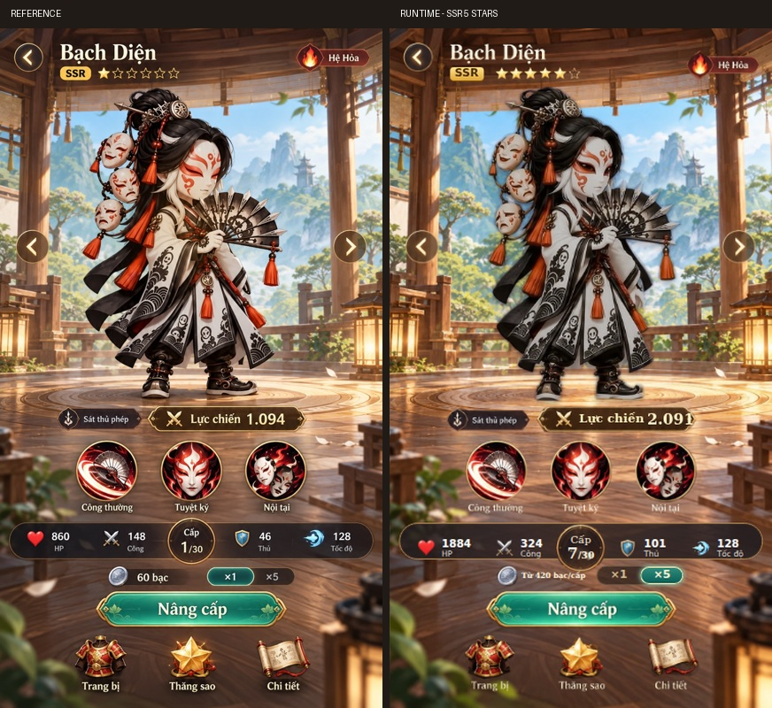

# Bạch Diện: supplied-reference slices and SSR five-star base

Continuation of Draft PR #382 on `7bc5581e4a78025c00711995335274820e2dc6db`. Owner rejected the previous approximated chrome and supplied the exact approved 864×1536 concept. Owner separately requested that SSR heroes start at five stars. No main merge or production promotion.

## Reference implementation

The name, element badge, role plate, arrows, six icons, labels, coin, star glyphs, level rim and lotus upgrade button are cropped from the supplied image. Crop coordinates/masks and provenance are in `assets/ui/hero-detail/reference-v3/source-map.json`. Power/level numbers were removed from plates; actual power, stats, level, price and stars remain live. Static raster labels retain semantic DOM names and real handlers. No decorative screenshot intercepts input.

The layout uses one uniformly scaled 9:16 artboard; power (55.53%), skills (60.55%), stats (72.72%), upgrade (82.68%) and footer (89.19%) are measured against it. Wider/taller screens contain the composition rather than stretching icons. Authored transparent canvas margins are accounted for to place the visible boots on the floor circle. Skill/feature buttons still open the original six-tab native sheet.

**Not 100% pixel parity:** the original animated character is retained and differs from the concept's still illustration; scenery hidden by the character/UI was reconstructed through ImageGen; dynamic text uses native font rendering. The screenshot comparison is evidence for owner review, not a claim that these differences are approved. Physical Safari remains untested.

## SSR star policy

- New SSR heroes have five real stars, not merely five painted glyphs. The existing six-star cap remains. This intentionally raises their real stat multiplier and relevant progression eligibility under the existing rules.
- Existing owned SSR at 1–4 stars become five; six-star heroes stay six. Non-SSR state and ownership are retained.
- Existing shard investment is preserved as a one-time refund credit. New free base stars do not grant shard refunds. A newly created SSR goes 5→6 for the existing 100-shard cost; Trả Mộng restores five and refunds only that paid 100. Repeating reset cannot manufacture shards.
- Domain policy is injected by the final build owner after existing registry/default/save patch anchors. Default, migration, persist, star reads and reset all use the policy. The old reward ceremony's singular `.star` lookup is corrected to the real star reader.

## Validation

- PASS: 9 Node tests (5 existing UI/installer cases, 4 new star-policy cases covering new heroes, legacy 1–6 migration/idempotence, non-SSR/ownership preservation, paid refunds and repeated reset).
- PASS: final star patch applies to the full downloaded production HTML, is idempotent, fails closed on anchor drift, and generated inline scripts parse.
- PASS: isolated guest Chromium at 320×700, 390×664, 390×844, 414×715, 1280×800. No horizontal overflow or scroll; footer visible. Measured anchor positions match the reference ratios within 0.4% of artboard height; this is a geometry assertion, not a whole-image similarity score.
- PASS: all six cropped icons decode; three skill shortcuts, six tabs, equipment/star sheet, Close/Escape and route-close; real ×1/×5 level transactions and capped partial batch.
- PASS: browser SSR starts saved/displayed at five, free-star refund zero; actual star-up 5→6 costs 100; actual reset returns to five and refunds 100; repeated reset grants nothing; legacy three-star migration preserves 60 paid shards and is idempotent. No captured JavaScript page exceptions.

[Browser measurements and transactions](browser-report.json)

Method: normal full deployed game HTML downloaded earlier, with changed source modules/CSS and the production star installer applied locally, and real atlas/reference crops served locally. This is not a clean repository build or certification of the new Vercel deployment. Guest currency is seeded only in isolated test state. Screenshots show different levels because transaction tests share that isolated guest session.

Not run: full clean build/full repository suite, exhaustive asset/network audit, physical iPhone Safari, new deployed-preview check. GitHub CLI/verified-push helper cannot run in this sparse connector workspace; source upload uses the connected GitHub API. CI/deploy/signature status must be reviewed separately. Existing vibelab-build/ticket-board tools remain unavailable; no workflow completion is asserted.
