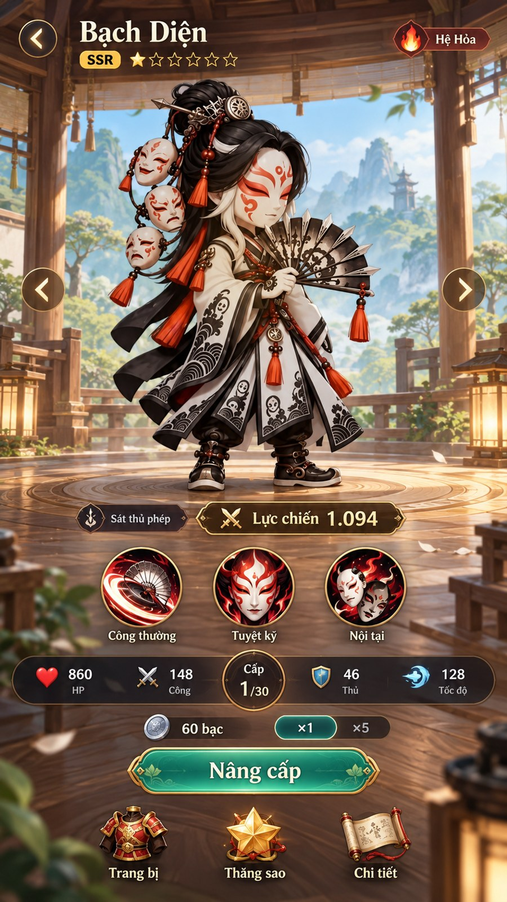
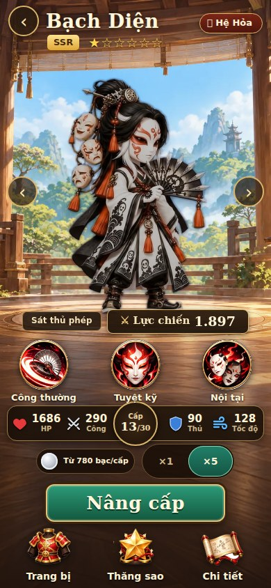
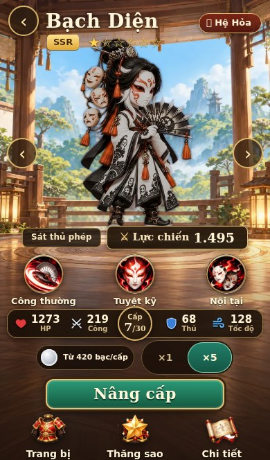
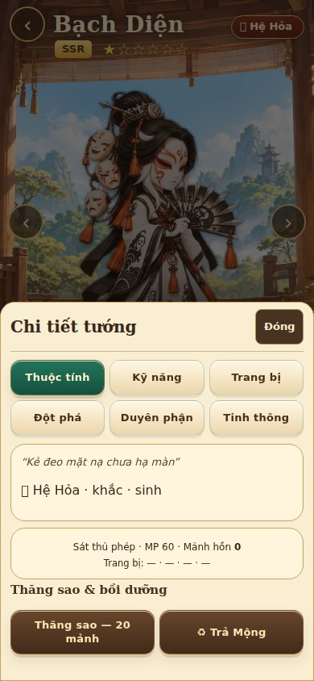
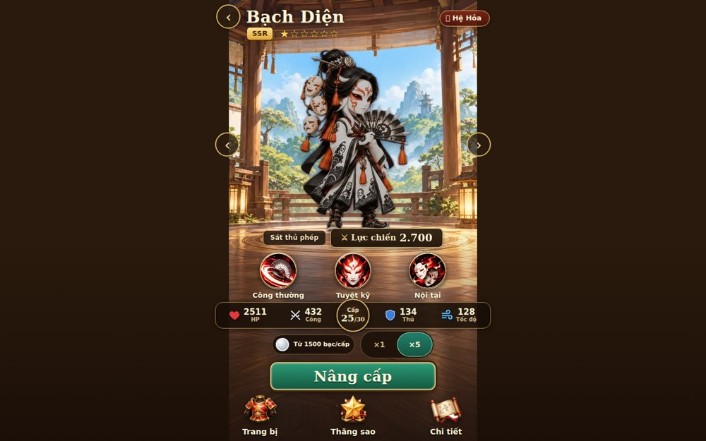

# Bạch Diện — compact Võ các review

This version supersedes the original panel-heavy concept and repair screenshots. Draft PR #382 only; main is not merged. Built on branch head e556f238a627e41a6a0b19679ec63d4a42d5e695, preserving its six individual icons, typography, stat symbols and original upgrade proxy handlers.

## Final behavior

- Original animated hero is the main subject against a portrait pavilion plate. Header contains name, rarity, stars and element; compact power, three skills and stat rows remain visible.
- One jade upgrade action uses the existing real handlers, with 44px ×1/×5 selectors. Batch price says “Từ … bạc/cấp” because successive levels have different costs. Selection survives rerender.
- Trang bị, Thăng sao and Chi tiết open a native bottom-sheet dialog containing the original six tabs and advanced actions. Each skill shortcut opens its actual skill content. Close, Escape and outside click dismiss the sheet; route changes also close it.
- Original artwork, canvas ratio, data, costs, saves and gameplay handlers are retained. Only Bạch Diện gets this layout. Background PR #379 is independent.

## Approved reference and actual runtime

The approved concept is a visual target, not a runtime screenshot; original animated character and live stats remain authoritative.

## Validation

- PASS: 5 focused Node tests across hero-detail-vo-cac and bach-dien-locked-layout suites; changed JavaScript syntax.
- PASS: Chromium at 320×700, 390×664, 390×844, 414×715 and 1280×800: no horizontal overflow, main footer within viewport. The shortest viewport has 8px extra bottom padding scroll, with all footer controls visible.
- PASS: all three skill shortcuts, all six detail tabs, equipment/star entry points, Close/Escape and closing the modal when leaving the hero route.
- PASS: actual ×1 and ×5 upgrade transactions at every viewport, including a partial batch at level cap; levels and charged costs checked against the existing game formula. Isolated guest currency was seeded solely for testing.
- PASS: original canvas has nontransparent pixels; inspected mobile and modal screenshots. Zero captured JavaScript page exceptions.

Method: execute the full previously downloaded deployed game HTML, substitute changed source modules/CSS, and serve the original hero atlas, branch icons and new background locally in an isolated browser. This is the normal game runtime, **not a clean build of the PR or certification of its Vercel deployment**. Screenshot levels differ because successive transaction checks use the same isolated guest state. Linux lacks some emoji glyphs; physical iOS rendering is unverified.

[Measured browser report](compact-browser-report.json)

Not run: clean full repository build/full test suite (sparse checkout), complete runtime asset/network audit, physical Safari, every economy/reset combination or deployed-preview verification. Repository-requested vibelab-build/ticket-board are unavailable. Full build and deployment review remain required before merge. Earlier repair artifacts remain as historical evidence only.
