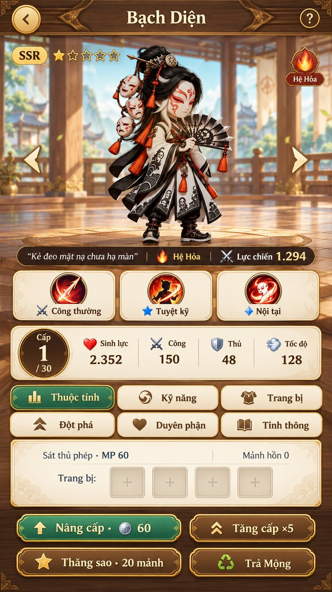
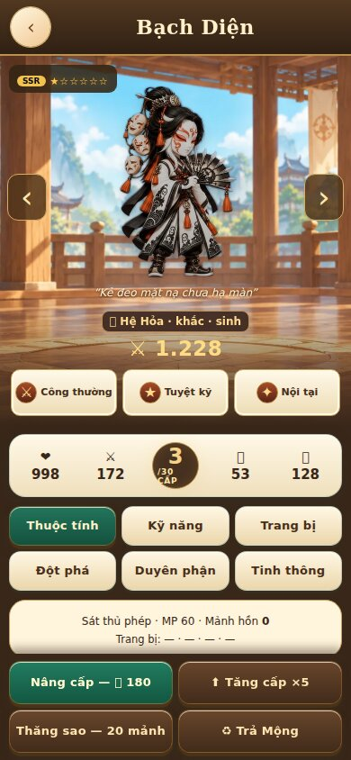
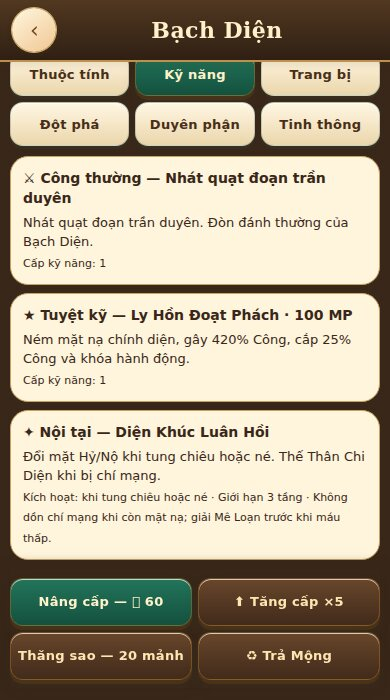
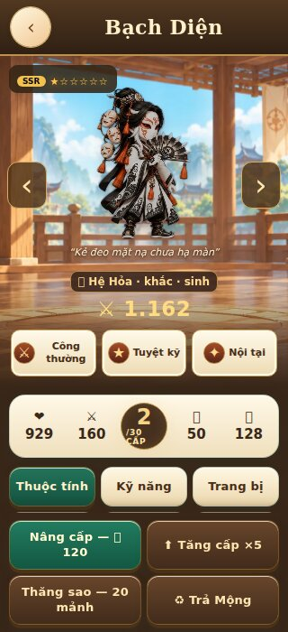
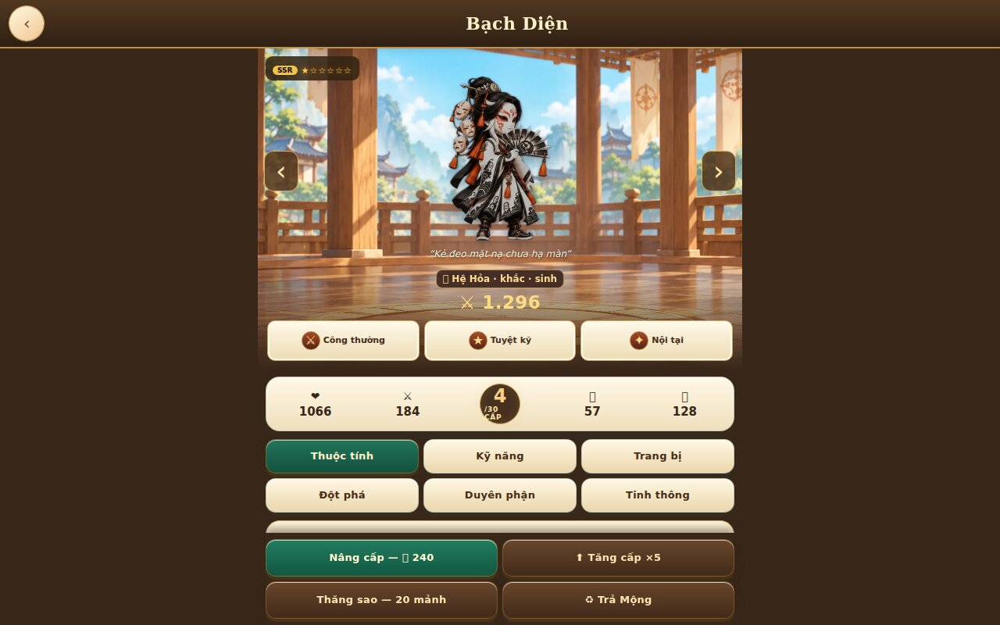

# Bạch Diện — Võ các preview

Owner approved the illustrated concept in chat and requested a separate PR. Base: `d3c63fa4c25c719e8e9046e42634fe0e65715882`. Draft only; no merge or production approval.

## Scope

The existing detail hall reparents `#hdBody` out of `#heroDetailScreen`. Much of the earlier tab/scene CSS consequently does not match the rendered overlay. Add a presentation stylesheet targeting the real `#hvHeroDetailRoot[data-hero-id="bach_dien"]`, loaded by the existing late `installCoreScreenPolish` build owner. The existing hall renderer records the current hero ID on its root, including when navigating to another hero.

Only Bạch Diện receives the new look in this PR. Other hero details and roster remain unchanged. The background PR #379 is separate.

- New clean pavilion background, warm brown/brass chrome, opaque ivory panels and jade primary action.
- Existing animated Bạch Diện canvas and authored mask/outfit remain the source of character art. No generated hero replacement.
- Six existing tabs, skill shortcuts, previous/next, Back, upgrade, five-level upgrade, star upgrade, reset, awakening, equipment, bonds and mastery retain their existing nodes and handlers.
- Bạch Diện moves the existing stat row and upgrades into real flex children without cloning controls/canvas. The action bar sticks to the overlay bottom; long tab content remains scrollable.
- No balance, save, cost, reward, animation-clock or roster changes. No UI text/numbers baked into background.

## Design reference versus implemented runtime

The concept is a visual target, not a pixel-exact screenshot of the implementation. Real skill symbols, six-star count, text and stats come from existing game data. The artwork's invented skill pictures are not substituted for game assets. The rendered implementation needs browser review before acceptance.

## Initial verification (first draft)

- PASS: `node --test tests/hero-detail-vo-cac.test.mjs` — 3 focused cases, covering real hall wrapper execution, current-hero scoping/reset on hero switch, Back and double-install guard, and existing late CSS installer preserving live markup/scripts.
- PASS: changed JavaScript parses; new WebP decodes as 1200 × 900.
- NOT RUN: clean full `npm run build` / full `npm test`; this workspace has a sparse connector checkout, not the full multi-asset repository.
- BLOCKED: desktop/mobile Chromium interaction and screenshot QA. Playwright is present but no browser executable; browser downloads returned invalid/truncated ZIP archives. No browser visual pass is claimed.
- NOT RUN: physical iPhone/Safari, production deployment, runtime asset-error audit.
- Repository-requested `vibelab-build` / ticket-board are unavailable in this session; no ticket status or workflow pass is claimed.

## Remaining acceptance before merge

Run full build/test and open the real game at 390×844, 320×700 and desktop. Open Bạch Diện from roster, inspect full body and moving idle, scroll through all six tabs, activate each skill shortcut, check enabled upgrade and ×5 against actual costs, test star/reset confirmation, navigate next/back and reopen. Verify no duplicated action, no horizontal overflow, readable disabled states, no missing assets/runtime exceptions, and >=44px controls. Review screenshots at top and at actions. Confirm another hero retains its previous layout. Physical Safari remains a separate check.

This draft intentionally does not certify screenshot parity or production readiness.

## Follow-up: owner iPhone screenshots, 26 October

Fixed the concrete regression: current manifests render Bạch Diện with `#authoredDetailIdle`, not the old `#bachDienDetailIdle` targeted in the first draft. The authored canvas now uses its existing cell aspect ratio with a bounded responsive display width. The rarity badge is anchored above the body, duplicate name below the portrait removed (header remains), and old global button sheen disabled within this preview only.

The existing tab owner moves live medals/workspace/upgrades directly into the Bạch Diện layout; upgrade actions remain sticky at the bottom without Safari `display:contents` dependencies. Skill text keeps descriptions, levels, costs, limits and counterplay while removing kit/animation implementation labels and translating the passive trigger. No changes to clocks, original art, data or action handlers.

### Follow-up evidence

Chromium could finally run from the npm-distributed Chromium executable. Used the **full previously downloaded deployed game HTML**, replacing the changed source modules and CSS before execution; loaded the actual Bạch Diện detail atlas (downloaded unchanged from production) and pavilion. This is the normal game runtime, not a fabricated UI fixture; it is **not** a clean build of this PR or certification of the updated Vercel deployment. A fresh isolated guest browser context was used; upgrade funding was supplied only to that test state.

- PASS: all 6 live tabs at 320×700, 390×844 and 1280×800 (18 switches).
- PASS: one actual Nâng cấp click at each viewport advanced exactly one level (1→2, 2→3, 3→4).
- PASS: original authored canvas has nontransparent pixels; viewed screenshots show full character. Its 480/440 ratio is retained.
- PASS: no horizontal overflow; all four action buttons remain within viewport and at least 44px high.
- PASS: zero captured JavaScript page exceptions in this run.
- PASS: original 3 focused Node tests and changed tabs JavaScript syntax.
- Screenshot inspection: 390px shows all six tabs, portrait and actions; at 320px secondary tabs require scrolling, while actions remain accessible. Skills retain their descriptions without technical debug strings. Desktop centers the content column. The Linux test browser lacks some color emoji glyphs; these screenshots do not certify icon font rendering on iOS.
- Still unverified: full repository clean build/test, complete runtime network/asset audit, all economy/reset combinations, physical Safari and updated PR deployment.

[Measured browser report](repair-browser-report.json)

