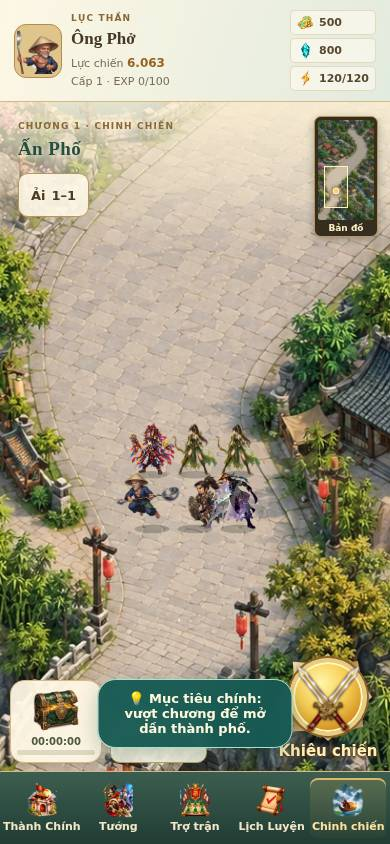
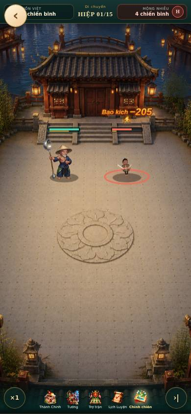
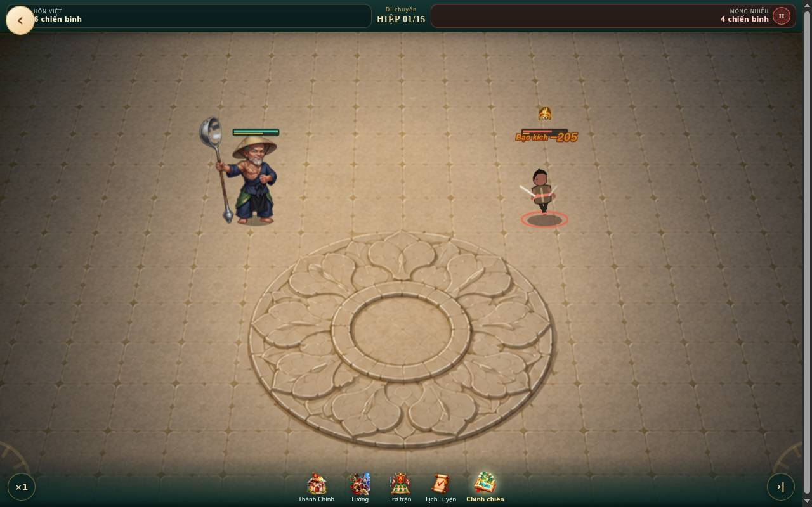

# One gesture across game screens

Baseline: main `c225c29c2db19b11b9068a72c4361656122429c9` (#290).
Branch: `fix/global-audio-unlock-20261008`. REVIEW only; no owner merge approval for this change.

The existing audio manager could accept a failed resume as unlocked and let an earlier pending resume swallow the real gesture. Embedded battle created a second context; iPhone entry replaced the host document and discarded its unlocked device. BGM routes used a separate media player from shared SFX/result music.

Existing owners now share the host Web Audio context, resume synchronously in the gesture, check actual running state and retain the latest requested music until unlock. BGM routes use the same bus as result music and voices, preserve profile volume, fallback tracks and async request ordering. Old BGM buffers are evicted from the cache while fading sources retain their own buffers. iPhone entry releases host images/atlases before opening the existing battle iframe; nested-preview/direct stalled-load recovery remains available. A full page reload/recovery creates a new document and is outside the preserved-session guarantee.

RED: six initial regression cases failed on baseline, including false unlock, a pending resume swallowing the gesture, a second iframe context and interrupted-state handling. Baseline startup also produced rejected resume promises. GREEN locally: 21 focused unlock/transition/iOS tests passed. Additional lifecycle cases passed; two require files/generated output unavailable in the sparse workspace. Fresh normal build/full suite and actual browser flow passed in the scoped GitHub workflow.

Browser acceptance: one trusted login click; wait for transient activation to expire; then use real navigation/buttons without new activation. Check hub, heroes, assist, shop, daily, campaign, UI SFX, voice, two battles, natural engine skip settlement, result audio and return. Require one context, shared child context, nonzero decoded PCM in running state, preserved host cleanup, no runtime/asset errors. Desktop and iPhone platform path in Chromium; physical Safari and device listening remain NOT_RUN. See the recorded final evidence below.

Initial normal-build workflow `37671895102` passed the build and 1692/1693 tests. Its sole failure was the old test requiring immediate top-level iPhone navigation. The revised test asserts retained host for desktop/iPhone and preserves nested-preview recovery coverage. No test was removed or skipped. General Vercel integrations reject the Git author because of existing project membership permissions; no preview/production deployment is certified.

## Verified final runtime

- Runtime commit: `f3559a4d80752d6ba0736248668a757b9997f0ca`.
- [Global audio unlock QA 37672878412](https://github.com/bktimmy247/luc-than/actions/runs/37672878412): SUCCESS. Full normal build and **1696/1696 tests** PASS.
- [report.json](report.json): desktop 1280×800 and iPhone-platform Chromium 390×844. Each keeps exactly **one trusted gesture and one host AudioContext** across six routes and two complete campaign entry/result/return cycles; each child creates zero contexts and shares the running host context.
- UI SFX and hero voice returned successful playback; music and combat buffer sources contained nonzero PCM in a running context. All four battles progressed through actual actions, used the existing skip engine and reached Victory. This does not certify a natural Defeat run or physical speaker output.
- iPhone path released 157 host image sources on each entry, suspended/cleared host atlas cache and restored the host after return. No top-level navigation during either normal battle. Runtime exceptions and asset HTTP errors: **0** in both profiles.
- Screenshots inspected: campaign squad/dock visible, active battle displayed and result reward/confirm controls visible. Result shots are immediate transition captures and are not a new result-animation/layout certification.
- Physical iPhone/Safari and actual-device listening: NOT_RUN. Production: unchanged. General CI is independent from this successful scoped workflow; do not infer all general browser checks from these audio checks.

