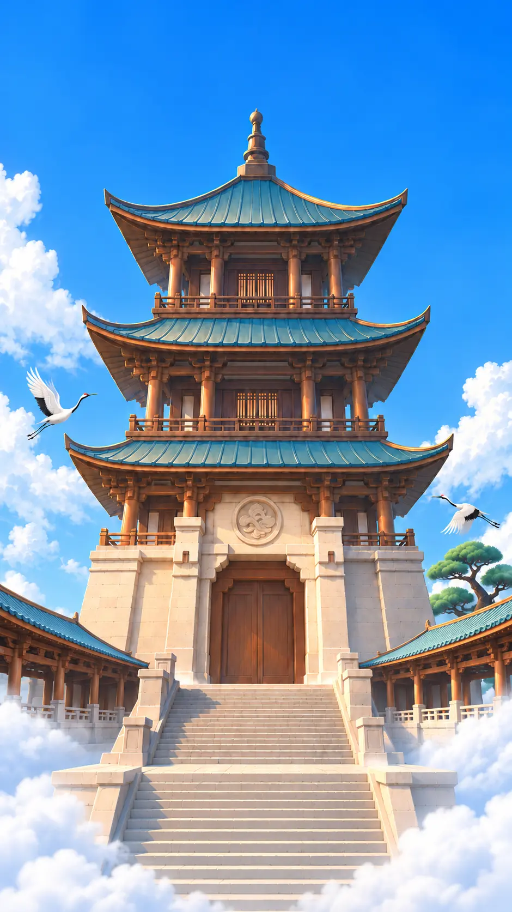

# Thành Chính — tháp, hành lang và hạc

Independent review branch from main 558516e5e829e913652802501e18cb319d363828; PR366 remains a separate manor proposal. Do not merge both alternatives without resolving their shared build owner.

## Scope
Replace only main-city scene with a clean three-tier tower, two low galleries, small right pine, two cranes and blue sky. Remove old decorative foreground gateway, because the new image already includes gateway/stairs. Live UI and gameplay unchanged. Single composed background; cranes are static, no new animation.

## Provenance
Owner-approved UI mockup: exec-313fa40c-c5aa-440d-85a2-885b7f356852.png. Built-in image generation extracted clean environment: exec-0bd24b92-3876-4d8f-97c7-98951eb9296d.png.
Prompt: remove all UI/browser/text; preserve clean three-tier teal-roof tower, ivory gate and steps, low side galleries, right pine, two cranes, blue sky/clouds; reconstruct obscured environment, no grain or ornament additions. Extraction may differ slightly from mockup, requiring runtime review.
Asset: assets/hub/an-ba-dao/main-city-tower-cranes-v1.webp; 940x1673, 117030 bytes, quality 92.

## Verification and review
Clean environment visually inspected. Three targeted patch tests PASS locally (PNG/WebP source references, gateway removal, preserve controls, idempotence and upstream drift failure).
Full build/npm test and desktop/mobile runtime interaction: NOT RUN locally; private clone authentication unavailable. Await PR CI and actual game screenshots. Physical iPhone/Safari NOT RUN. Production NOT REQUESTED. Workflow skill/ticket board unavailable; no full workflow PASS claimed. Draft review only.

