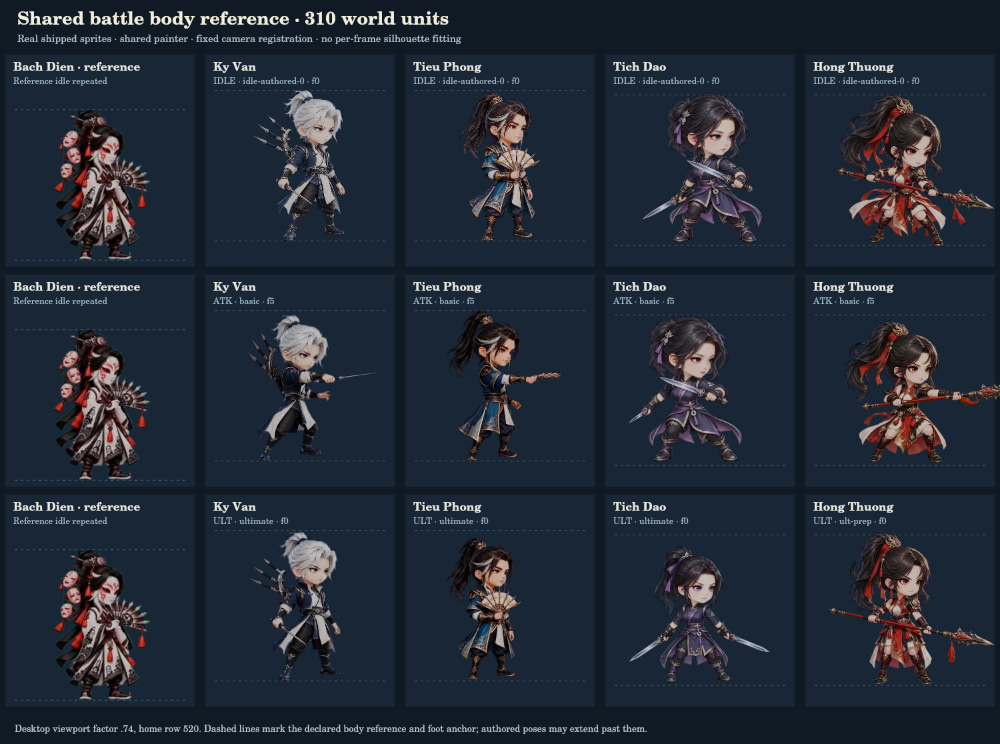

# Shared battle hero size — review evidence

Status: REVIEW / draft PR. This follow-up has not been merged or verified in production.

## Request and result

Use one stature standard for every hero in battle, across idle, basic attack and ultimate. Adding a hero must not require a new handwritten scale coefficient in the battle renderer. Bạch Diện is the visual reference.

The shared body reference is **310 world units before viewport and home-slot depth**. Ten authored hero families declare source measurements in `presentation.json`. The registry derives their corrections, and the four direct actor painters use one fixed registration function. Generated-sheet and procedural fallbacks use the same body reference. The unscaled S+ pending-art card keeps a HUD based on its actual rectangle; an authored profile takes precedence over that old card flag.

See [the integration contract](../HERO-BATTLE-SIZE-CONTRACT.md) for measurements, equations and the new-hero workflow.

## Acceptance covered

- Preserve Bạch Diện's approved battle stature and existing portrait/desktop viewport factors.
- Use standing-equivalent source body height and fixed foot registration. Weapons, particles, padding and whole-frame alpha bounds do not define stature.
- Keep one source-camera density through idle, ATK and ultimate. Crouching, jumping, running and falling retain authored pose changes; there is no per-frame silhouette fitting.
- Discover IDs, aliases and measurements from asset metadata. A directory with `runtime-meta.json` but no valid presentation manifest fails before asset assembly. Unclassified clips and invalid character geometry also fail.
- Share body dimensions between character rendering, HUD and target impacts. VFX retain independent display rectangles.
- Preserve formation positions, home-slot depth during movement, one enemy mirror, animation clocks and the existing visibility-cache boundary.

## Scope and process

Base: main `de5d425e11719cd275112953d539339e2eb4b77a` after PR #310. Branch: `fix/shared-hero-scale-contract-20261017`.

The existing documented Ticket Board/workflow availability waiver applies; this note makes no ticket-state claim. A sparse local checkpoint was taken before production edits. Shell networking to GitHub is unavailable; repository operations use the connected GitHub tools. VibeLab archive retrieval through its prescribed helper failed with a network error.

## Verification

### Regression first

The initial independent body-standard test passed Bạch Diện and Linh Đồng and failed Kỷ Vân, Tiêu Phong, Tịch Dao and Hồng Thương. Generated-pose and procedural-fallback tests also exposed inconsistent source density / stacked authored correction before their fixes.

The final focused runs passed **67 tests, with zero failures**: 50 shared-contract, formation, fallback, actor-renderer and Hồng Thương regression tests, plus 17 selected existing Kỷ Vân / Tiêu Phong / Tịch Dao runtime tests.

```sh
node --test --test-isolation=none \
  tests/hero-presentation-contract.test.mjs \
  tests/hero-body-standard.test.mjs \
  tests/battle-formation-visual-scale.test.mjs \
  tests/battle-scale-integrity.test.mjs \
  tests/new-hero-idle-scale.test.mjs \
  tests/generated-hero-stature.test.mjs \
  tests/hong-thuong-runtime-regression.test.mjs \
  tests/hero-runtime-stature.test.mjs

node --test --test-isolation=none \
  --test-name-pattern='idle|body|death|hit, run|basic sends|viewport|three ground|host composes|authored timing|supplied idle|dash|thân|nine authored|waitTich|VFX center' \
  tests/ky-van-runtime.test.mjs \
  tests/tieu-phong-runtime.test.mjs \
  tests/tich-dao-runtime.test.mjs

node scripts/hero-presentation-registry.mjs
```

The registry command reports **10 valid families**. `--test-isolation=none` avoids this workspace's child-process EPERM restriction; it does not skip individual tests in the first command.

Coverage includes ten family reference heights on both teams and two viewport classes; actual injected helpers plus four direct actor renderers through idle/ATK/ultimate; source-only half-atlas sampling; 30-pose idle pages; generic poses and the actual procedural skeleton; a synthetic future hero needing no ID-table edit; metadata rejection; home-depth stability; HUD/impact centers; and Hồng Thương cold-cache/timeline regression checks.

A composition test checks all four late installers have one helper and HUD owner. It explicitly supplies the unrelated earlier Bạch Diện effects hook; that fixture is not a full build.

### Visual evidence



This offline Canvas comparison uses shipped sprites, the shared painter for Kỷ Vân / Tiêu Phong / Tịch Dao / Hồng Thương, and the existing Bạch Diện renderer. It compares idle, basic-attack frame 5 and ultimate frame 0 (Hồng Thương's preparation clip) at desktop factor 0.74 and home row 520. Dashed lines show declared body and foot references; original foot offsets are retained. Bạch Diện's reference idle is repeated in all three rows.

The final image was visually inspected. Body proportions remain stable, weapon overhang does not shrink the character, and Tịch Dao's lower ultimate stance is retained. This is rendering evidence, not a screenshot of a running production battle.

The shipped Ông Phở image was inspected separately: the ladle/staff rises above the body. Its reference uses the body-only source range y=23..125 (103 pixels), excluding that prop. Đình Lôi's source measurement uses the shipped half-resolution campaign-lite atlas with the corresponding source density.

## Remaining review limits

- This is a sparse checkout. No complete static build, entire repository test suite, live-browser battle or physical iPhone/Safari pass was completed. A Ready preview and in-game idle/ATK/ultimate review remain required before merging this follow-up.
- An exploratory unfiltered run exposed existing Kỷ Vân VFX expectations of 20 bolts where the base runtime emits 15, and a Tiêu Phong fixture missing `window`. Both were reproduced with the base runtime. These unrelated assertions were not rewritten to claim a green full suite.
- Linh Đồng, Lục Ảnh and Thầy Mo retain documented legacy packing / cell-bottom foot proxies. Their anatomical foot landmarks have not all been independently remeasured.
- Ông Phở, Đình Lôi and Thầy Mo use pre-registered legacy renderers without a `runtime-meta.json` inventory. Their profiles validate, but automatic source-clip inventory coverage is available only for the seven metadata-backed families.
- A new export still needs correct source body / foot metadata. The system does not guess anatomy from opaque pixels containing weapons or VFX.
